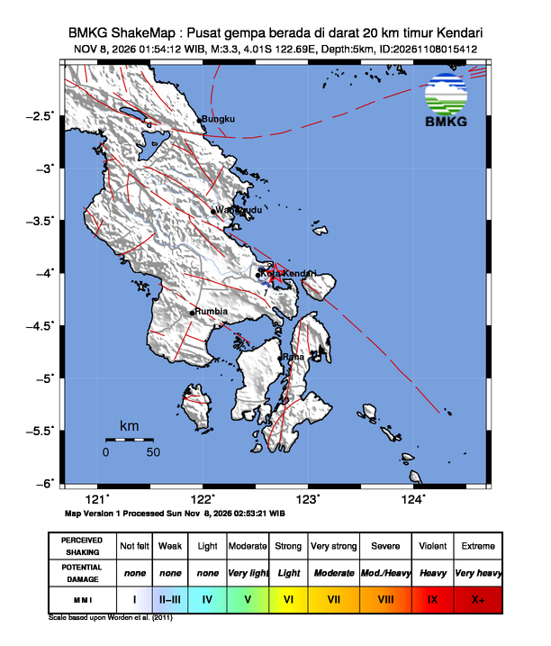

# 🌍 AutoGempa — Informasi Gempa Terkini Indonesia

> Monitor gempa bumi real-time untuk wilayah Indonesia. Data diambil otomatis dari **BMKG** setiap 5 menit oleh GitHub Actions, lalu ditampilkan lengkap di README ini beserta peta guncangannya (shakemap).

🕒 **Update otomatis terakhir:** Jumat, 06 November 2026 pukul 22.23.47

---

## 🚨 Gempa Terkini

| Parameter | Detail |
| --- | --- |
| 📊 **Magnitudo** | M 4.3 |
| 📍 **Wilayah** | Pusat gempa berada di darat 130 km barat laut Kep. Mentawai |
| 🕒 **Waktu** | 06 Nov 2026, 17:30:55 WIB |
| 🧭 **Koordinat** | -1.19,98.73 |
| 📏 **Kedalaman** | 17 km |
| 🌊 **Potensi** | Gempa ini dirasakan untuk diteruskan pada masyarakat |
| 📡 **Dirasakan** | III Siberut Barat, III Siberut Utara, II Siberut Tengah, I Kab. Nias Selatan |
| 🔗 **Sumber** | [BMKG — InfoGempa Realtime](https://www.bmkg.go.id/gempabumi) |

### 🗺️ Peta Guncangan (Shakemap)

---

## 📜 Riwayat 15 Gempa Terakhir

| Waktu | Magnitudo | Wilayah | Kedalaman | Potensi |
| --- | --- | --- | --- | --- |
| 06 Nov 2026 17:30:55 WIB | **M 4.3** | Pusat gempa berada di darat 130 km barat laut Kep. Mentawai | 17 km | Gempa ini dirasakan untuk diteruskan pada masyarakat |
| 04 Nov 2026 14:56:34 WIB | **M 3.4** | Pusat gempa berada di darat 40 km timur laut Sigi | 10 km | Gempa ini dirasakan untuk diteruskan pada masyarakat |
| 04 Nov 2026 07:50:34 WIB | **M 4.4** | Pusat gempa berada di laut 88 km timur laut Ruteng, Manggarai | 15 km | Gempa ini dirasakan untuk diteruskan pada masyarakat |
| 04 Nov 2026 03:28:35 WIB | **M 4.1** | Pusat gempa berada di darat 61 km utara Luwu Timur | 6 km | Gempa ini dirasakan untuk diteruskan pada masyarakat |
| 03 Nov 2026 22:37:50 WIB | **M 4.8** | Pusat gempa berada di laut 86 km Selatan Kota Gorontalo | 87 km | Gempa ini dirasakan untuk diteruskan pada masyarakat |
| 02 Nov 2026 16:58:58 WIB | **M 2.6** | Pusat gempa berada di darat 9 km Utara Kota Jayapura | 8 km | Gempa ini dirasakan untuk diteruskan pada masyarakat |
| 02 Nov 2026 07:53:11 WIB | **M 5.5** | Pusat gempa berada di laut 169 km BaratLaut Tanimbar | 130 km | Gempa ini dirasakan untuk diteruskan pada masyarakat |
| 01 Nov 2026 12:38:59 WIB | **M 4.1** | Pusat gempa berada di darat 24 km Barat Daya Kab. Pidie Jaya-Aceh | 6 km | Gempa ini dirasakan untuk diteruskan pada masyarakat |
| 01 Nov 2026 03:48:49 WIB | **M 2.8** | Pusat gempa berada di darat 14 km Timur Laut Kendari | 10 km | Gempa ini dirasakan untuk diteruskan pada masyarakat |
| 31 Okt 2026 15:23:13 WIB | **M 3.5** | Pusat gempa berada di laut 13 km tenggara Bahodopi | 4 km | Gempa ini dirasakan untuk diteruskan pada masyarakat |
| 31 Okt 2026 12:39:20 WIB | **M 4.8** | Pusat gempa berada di laut 97 km barat Kodi, Sumba Barat Daya | 28 km | Gempa ini dirasakan untuk diteruskan pada masyarakat |
| 30 Okt 2026 17:29:39 WIB | **M 3.5** | Pusat gempa berada di darat 7 km barat daya Samosir | 3 km | Gempa ini dirasakan untuk diteruskan pada masyarakat |
| 30 Okt 2026 03:32:13 WIB | **M 5.3** | 139 km BaratLaut TUAL-MALUKU | 10 km | Tidak berpotensi tsunami |
| 29 Okt 2026 10:26:49 WIB | **M 6** | Pusat gempa berada di darat 153 km tenggara Oksibil | 120 km | Gempa ini dirasakan untuk diteruskan pada masyarakat |
| 29 Okt 2026 05:06:47 WIB | **M 6.4** | Pusat gempa berada di laut 60 km Baratlaut Larat-Kep.Tanimbar | 160 km | Gempa ini dirasakan untuk diteruskan pada masyarakat |

---

## 🛠️ Cara Kerja Repository Ini

- Workflow `.github/workflows/bmkg.yml` berjalan otomatis setiap **5 menit**.
- `src/index.js` mengambil data dari `https://data.bmkg.go.id/DataMKG/TEWS/autogempa.json`.
- Jika terdeteksi gempa **baru**:
  - `README.md` di-generate ulang (info detail + shakemap),
  - gambar shakemap disimpan ke `assets/shakemap.jpg`,
  - riwayat disimpan di `data/history.json` (maksimal 15 gempa),
  - checkpoint ID disimpan di `data/last.json`,
  - semua di-commit & push otomatis ke branch `main`.
- **Fitur Self-Healing**: jika BMKG merilis parameter gempa lebih dulu dan gambar shakemap menyusul beberapa menit kemudian, sistem otomatis mengunduh shakemap susulan dan memperbarui `README.md` tanpa menduplikasi notifikasi.
- Notifikasi **Discord** tetap dikirim jika magnitudo ≥ `MIN_MAGNITUDE`.

---

Dibuat dengan ❤️ oleh [RusdiEneri](https://github.com/RusdiEneri) • Sumber data: [BMKG](https://www.bmkg.go.id/)

_README ini dibuat otomatis oleh GitHub Actions — jangan edit manual._

