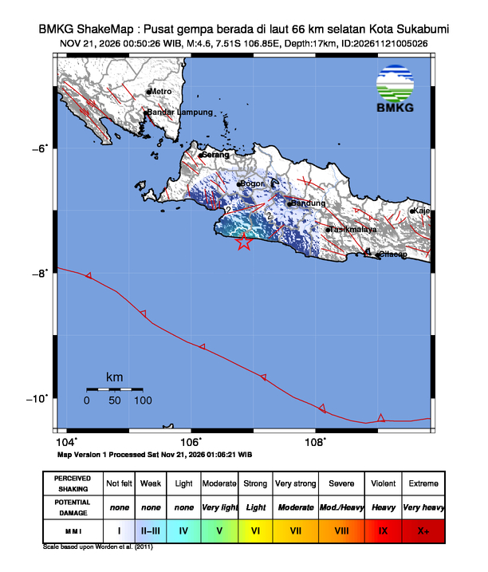

# 🌍 AutoGempa — Informasi Gempa Terkini Indonesia

> Monitor gempa bumi real-time untuk wilayah Indonesia. Data diambil otomatis dari **BMKG** setiap 5 menit oleh GitHub Actions, lalu ditampilkan lengkap di README ini beserta peta guncangannya (shakemap).

🕒 **Update otomatis terakhir:** Senin, 16 November 2026 pukul 04.49.57

---

## 🚨 Gempa Terkini

| Parameter | Detail |
| --- | --- |
| 📊 **Magnitudo** | M 5.4 |
| 📍 **Wilayah** | 265 km Tenggara BURUSELATAN-MALUKU |
| 🕒 **Waktu** | 16 Nov 2026, 03:51:57 WIB |
| 🧭 **Koordinat** | -5.97,128.82 |
| 📏 **Kedalaman** | 323 km |
| 🌊 **Potensi** | Tidak berpotensi tsunami |
| 🔗 **Sumber** | [BMKG — InfoGempa Realtime](https://www.bmkg.go.id/gempabumi) |

### 🗺️ Peta Guncangan (Shakemap)

---

## 📜 Riwayat 15 Gempa Terakhir

| Waktu | Magnitudo | Wilayah | Kedalaman | Potensi |
| --- | --- | --- | --- | --- |
| 16 Nov 2026 03:51:57 WIB | **M 5.4** | 265 km Tenggara BURUSELATAN-MALUKU | 323 km | Tidak berpotensi tsunami |
| 15 Nov 2026 22:41:15 WIB | **M 5.4** | 127 km BaratLaut GORONTALOUTARA-GORONTALO | 465 km | Tidak berpotensi tsunami |
| 15 Nov 2026 04:24:20 WIB | **M 4.5** | Pusat gempa berada di laut 56 km utara Ruteng, Manggarai | 2 km | Gempa ini dirasakan untuk diteruskan pada masyarakat |
| 13 Nov 2026 14:31:39 WIB | **M 4.1** | Pusat gempa berada di laut 24 km selatan Enggano | 24 km | Gempa ini dirasakan untuk diteruskan pada masyarakat |
| 13 Nov 2026 11:49:34 WIB | **M 4.9** | Pusat gempa berada di laut 29 km Barat Laut PULAUPANJANG | 17 km | Gempa ini dirasakan untuk diteruskan pada masyarakat |
| 13 Nov 2026 02:14:40 WIB | **M 4.6** | Pusat gempa berada di laut 32 km barat laut Pulau Panjang | 17 km | Gempa ini dirasakan untuk diteruskan pada masyarakat |
| 12 Nov 2026 18:16:30 WIB | **M 4.8** | Pusat gempa berada di laut 73 km Timur Laut Ruteng, Manggarai | 13 km | Gempa ini dirasakan untuk diteruskan pada masyarakat |
| 11 Nov 2026 06:05:21 WIB | **M 4.3** | Pusat gempa berada di darat 23 km timur laut Kab. Gayo Lues | 5 km | Gempa ini dirasakan untuk diteruskan pada masyarakat |
| 10 Nov 2026 23:04:15 WIB | **M 4** | Pusat gempa berada di darat 12 km timur Konawe Selatan | 5 km | Gempa ini dirasakan untuk diteruskan pada masyarakat |
| 10 Nov 2026 15:34:04 WIB | **M 5.3** | Pusat gempa berada di laut 69 km barat laut Kebar Manokwari | 10 km | Gempa ini dirasakan untuk diteruskan pada masyarakat |
| 10 Nov 2026 08:53:28 WIB | **M 5.4** | 90 km BaratDaya TANIMBAR | 84 km | Tidak berpotensi tsunami |
| 09 Nov 2026 17:38:54 WIB | **M 3.9** | Pusat gempa berada di laut 44 km timur laut Mbay-Nagekeo | 10 km | Gempa ini dirasakan untuk diteruskan pada masyarakat |
| 09 Nov 2026 07:44:58 WIB | **M 2.5** | Pusat gempa berada di laut 1 km timur Jailolo | 10 km | Gempa ini dirasakan untuk diteruskan pada masyarakat |
| 08 Nov 2026 01:54:12 WIB | **M 3.3** | Pusat gempa berada di darat 20 km timur Kendari | 5 km | Gempa ini dirasakan untuk diteruskan pada masyarakat |
| 07 Nov 2026 17:05:52 WIB | **M 3** | Pusat gempa berada di darat 31 km utara Lombok Timur | 10 km | Gempa ini dirasakan untuk diteruskan pada masyarakat |

---

## 🛠️ Cara Kerja Repository Ini

- Workflow `.github/workflows/bmkg.yml` berjalan otomatis setiap **5 menit**.
- `src/index.js` mengambil data dari `https://data.bmkg.go.id/DataMKG/TEWS/autogempa.json`.
- Jika terdeteksi gempa **baru**:
  - `README.md` di-generate ulang (info detail + shakemap),
  - gambar shakemap disimpan ke `assets/shakemap.jpg`,
  - riwayat disimpan di `data/history.json` (maksimal 15 gempa),
  - checkpoint ID disimpan di `data/last.json`,
  - semua di-commit & push otomatis ke branch `main`.
- **Fitur Self-Healing**: jika BMKG merilis parameter gempa lebih dulu dan gambar shakemap menyusul beberapa menit kemudian, sistem otomatis mengunduh shakemap susulan dan memperbarui `README.md` tanpa menduplikasi notifikasi.
- Notifikasi **Discord** tetap dikirim jika magnitudo ≥ `MIN_MAGNITUDE`.

---

Dibuat dengan ❤️ oleh [RusdiEneri](https://github.com/RusdiEneri) • Sumber data: [BMKG](https://www.bmkg.go.id/)

_README ini dibuat otomatis oleh GitHub Actions — jangan edit manual._

