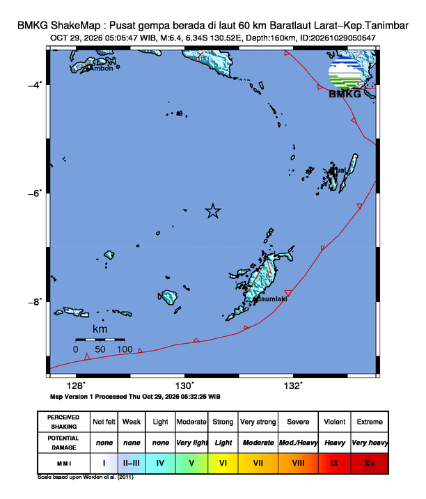

# 🌍 AutoGempa — Informasi Gempa Terkini Indonesia

> Monitor gempa bumi real-time untuk wilayah Indonesia. Data diambil otomatis dari **BMKG** setiap 5 menit oleh GitHub Actions, lalu ditampilkan lengkap di README ini beserta peta guncangannya (shakemap).

🕒 **Update otomatis terakhir:** Kamis, 29 Oktober 2026 pukul 15.56.58

---

## 🚨 Gempa Terkini

| Parameter | Detail |
| --- | --- |
| 📊 **Magnitudo** | M 6 |
| 📍 **Wilayah** | Pusat gempa berada di darat 153 km tenggara Oksibil |
| 🕒 **Waktu** | 29 Okt 2026, 10:26:49 WIB |
| 🧭 **Koordinat** | -5.45,141.90 |
| 📏 **Kedalaman** | 120 km |
| 🌊 **Potensi** | Gempa ini dirasakan untuk diteruskan pada masyarakat |
| 📡 **Dirasakan** | III Boven Digoel, II Jayapura, II Merauke |
| 🔗 **Sumber** | [BMKG — InfoGempa Realtime](https://www.bmkg.go.id/gempabumi) |

### 🗺️ Peta Guncangan (Shakemap)

---

## 📜 Riwayat 15 Gempa Terakhir

| Waktu | Magnitudo | Wilayah | Kedalaman | Potensi |
| --- | --- | --- | --- | --- |
| 29 Okt 2026 10:26:49 WIB | **M 6** | Pusat gempa berada di darat 153 km tenggara Oksibil | 120 km | Gempa ini dirasakan untuk diteruskan pada masyarakat |
| 29 Okt 2026 05:06:47 WIB | **M 6.4** | Pusat gempa berada di laut 60 km Baratlaut Larat-Kep.Tanimbar | 160 km | Gempa ini dirasakan untuk diteruskan pada masyarakat |
| 28 Okt 2026 18:59:15 WIB | **M 3.4** | Pusat gempa berada di darat 10 km Utara Tanggamus | 4 km | Gempa ini dirasakan untuk diteruskan pada masyarakat |
| 28 Okt 2026 08:11:54 WIB | **M 5.4** | 221 km BaratLaut PULAUKARATUNG-SULUT | 10 km | Tidak berpotensi tsunami |
| 27 Okt 2026 21:43:13 WIB | **M 5.4** | Pusat gempa berada di laut 137 km Selatan Gunungkidul | 10 km | Gempa ini dirasakan untuk diteruskan pada masyarakat |
| 26 Okt 2026 11:53:42 WIB | **M 4.9** | Pusat gempa berada di laut 30 km timur laut Mbay, Nagekeo | 13 km | Gempa ini dirasakan untuk diteruskan pada masyarakat |
| 25 Okt 2026 19:47:26 WIB | **M 3.8** | Pusat gempa berada di laut 13 km timur laut Kota Sorong | 6 km | Gempa ini dirasakan untuk diteruskan pada masyarakat |
| 25 Okt 2026 14:40:01 WIB | **M 4.7** | Pusat gempa berada di darat 44 km barat Kab. Aceh Tamiang | 10 km | Gempa ini dirasakan untuk diteruskan pada masyarakat |
| 22 Okt 2026 17:57:49 WIB | **M 5.2** | Pusat gempa berada di darat 6 km BaratLaut Lebong | 120 km | Gempa ini dirasakan untuk diteruskan pada masyarakat |
| 21 Okt 2026 18:58:36 WIB | **M 2.5** | Pusat gempa berada di darat 9 km utara Tanggamus | 3 km | Gempa ini dirasakan untuk diteruskan pada masyarakat |
| 21 Okt 2026 14:44:15 WIB | **M 5.1** | 62 km TimurLaut MALUKUBRTDAYA | 96 km | Tidak berpotensi tsunami |
| 20 Okt 2026 23:29:35 WIB | **M 5.4** | Pusat gempa berada di laut 59 km barat daya Meulaboh | 74 km | Gempa ini dirasakan untuk diteruskan pada masyarakat |
| 20 Okt 2026 18:28:11 WIB | **M 3.7** | Pusat gempa berada di laut 6 km Barat Laut Pulau Saringi | 15 km | Gempa ini dirasakan untuk diteruskan pada masyarakat |
| 20 Okt 2026 16:56:38 WIB | **M 3.4** | Pusat gempa berada di darat 30km Barat Daya Kab. Kupang | 4 km | Gempa ini dirasakan untuk diteruskan pada masyarakat |
| 19 Okt 2026 20:46:11 WIB | **M 4.2** | Pusat gempa berada di darat 26 km Timur Laut Kab. Gayo Lues | 5 km | Gempa ini dirasakan untuk diteruskan pada masyarakat |

---

## 🛠️ Cara Kerja Repository Ini

- Workflow `.github/workflows/bmkg.yml` berjalan otomatis setiap **5 menit**.
- `src/index.js` mengambil data dari `https://data.bmkg.go.id/DataMKG/TEWS/autogempa.json`.
- Jika terdeteksi gempa **baru**:
  - `README.md` di-generate ulang (info detail + shakemap),
  - gambar shakemap disimpan ke `assets/shakemap.jpg`,
  - riwayat disimpan di `data/history.json` (maksimal 15 gempa),
  - checkpoint ID disimpan di `data/last.json`,
  - semua di-commit & push otomatis ke branch `main`.
- **Fitur Self-Healing**: jika BMKG merilis parameter gempa lebih dulu dan gambar shakemap menyusul beberapa menit kemudian, sistem otomatis mengunduh shakemap susulan dan memperbarui `README.md` tanpa menduplikasi notifikasi.
- Notifikasi **Discord** tetap dikirim jika magnitudo ≥ `MIN_MAGNITUDE`.

---

Dibuat dengan ❤️ oleh [RusdiEneri](https://github.com/RusdiEneri) • Sumber data: [BMKG](https://www.bmkg.go.id/)

_README ini dibuat otomatis oleh GitHub Actions — jangan edit manual._

